<a href="https://yingchiehwang.com/ja">
  <picture>
    <source media="(prefers-color-scheme: dark)" srcset="assets/header-dark-ja.svg">
    
  </picture>
</a>

  
  
  
  
  
  

<a href="README.md">English</a> · <a href="README.zh-TW.md">繁體中文</a> · <b>日本語</b>

大阪大学大学院 情報科学研究科 修士1年。機械学習で都市規模シミュレーションを高速化する研究と、Android アプリ・ゲームの個人開発に取り組んでいます。

### 🔭 研究

**空飛ぶクルマによる光害の予測** · 大阪大学 山口研究室

空飛ぶクルマ（Urban Air Mobility）は、太陽光を街路や窓に反射します。都市全体のまぶしさを予測するため、問題を二つに分けました。遮蔽のない環境で一度だけ学習し、再学習なしで都市をまたいで使える幾何情報を考慮したニューラルサロゲート（PyTorch 3D-CNN + MLP）と、都市ごとの建物から計算する幾何学的な遮蔽補正です。

- ⚡ **レイトレーシング：3 時間超 → 1.62 秒**：1 万地点・5 秒間（10 Hz）の予測、都市の初回初期化後
- 🎯 ローマ・台北・ニューヨーク（18 設定）で、補正前のニューラル予測より **RMSE を 10–54% 改善**。高層が密集するニューヨークで precision を**相対 32–91% 向上**

**IEEE SmartComp 2026** 筆頭著者 · 🏆 **情報処理学会 ITS 研究会 2026** 奨励発表賞 · 論文誌の拡張版を査読中 · [詳しく →](https://yingchiehwang.com/ja/research)

### 🛠️ ForgerWise のプロダクト

**[Wiser Locker](https://www.wiserlocker.com)** · Android · Flutter + SQLCipher  
写真・動画を端末内で暗号化し、フォルダではなくタグで整理できるアプリです。Firebase のバックエンド（Cloud Functions、Firestore、App Check）で Google Play のサブスクリプションを処理し、Google Drive によるエンドツーエンド暗号化のクラウド同期に対応しています。 [Google Play ↗](https://play.google.com/store/apps/details?id=com.forgerwise.wiserlocker)  
  
 

**[FoodList](https://github.com/ForgerWise/FoodList)** · Android · Flutter + Hive  
家の食材と期限を記録し、無駄にする前に使い切るためのアプリです。 [Google Play ↗](https://play.google.com/store/apps/details?id=com.forgerwise.foodlist)  
  
 

**[Galaxization](https://galaxization.com)** · デスクトップゲーム · Windows / macOS / Linux  
壁紙の上で銀河が進化し続け、数百の文明がひとりでに興り、争い、昇華していきます。Steam で近日公開。
 

### 💼 経歴

**ハウテレビジョン** · 2026年10月 · 2日間の開発インターン — Claude Code と GitHub の PR／CI で開発。課題の KPI で全参加者中上位 3 位  
**エムスリー** · 2026年10月 · 2日間のデータ分析インターン — 架空のビジネスケースで、データに基づく販促施策を提案（pandas、statsmodels）  
**スタンバイ** · 2026年8月 · 4日間のハッカソン — 自動応募機能のアーキテクチャと Python バックエンド。操作可能なデモを完成  
**PKSHA Technology** · 2024年9月 · 2週間 — Slack の投稿を LLM の要約付きでランキングするサーバーレスツール（AWS Lambda、EventBridge、Azure AI）  
**H&K** · 2023年12月 – 2024年5月 · アルバイト — HubSpot × fincode の決済連携（Flask、AWS Lambda）。リリース前にプロジェクトは中止

### 🧰 技術スタック

**言語** 
<picture><source media="(prefers-color-scheme: dark)" srcset="https://skillicons.dev/icons?i=py&theme=dark"></picture>
<picture><source media="(prefers-color-scheme: dark)" srcset="https://skillicons.dev/icons?i=cpp&theme=dark"></picture>
<picture><source media="(prefers-color-scheme: dark)" srcset="https://skillicons.dev/icons?i=c&theme=dark"></picture>
<picture><source media="(prefers-color-scheme: dark)" srcset="https://skillicons.dev/icons?i=dart&theme=dark"></picture>
<picture><source media="(prefers-color-scheme: dark)" srcset="https://skillicons.dev/icons?i=java&theme=dark"></picture>
<picture><source media="(prefers-color-scheme: dark)" srcset="https://skillicons.dev/icons?i=ts&theme=dark"></picture>
<picture><source media="(prefers-color-scheme: dark)" srcset="https://skillicons.dev/icons?i=js&theme=dark"></picture>
<picture><source media="(prefers-color-scheme: dark)" srcset="https://skillicons.dev/icons?i=html&theme=dark"></picture>
<picture><source media="(prefers-color-scheme: dark)" srcset="https://skillicons.dev/icons?i=css&theme=dark"></picture>
 Python · C++ · C · Dart · Java · TypeScript · JavaScript · HTML · CSS

**AI・研究** 
<picture><source media="(prefers-color-scheme: dark)" srcset="https://skillicons.dev/icons?i=pytorch&theme=dark"></picture>
<picture><source media="(prefers-color-scheme: dark)" srcset="https://skillicons.dev/icons?i=unreal&theme=dark"></picture>
 PyTorch · Unreal Engine 5

**バックエンド・クラウド** 
<picture><source media="(prefers-color-scheme: dark)" srcset="https://skillicons.dev/icons?i=flask&theme=dark"></picture>
<picture><source media="(prefers-color-scheme: dark)" srcset="https://skillicons.dev/icons?i=fastapi&theme=dark"></picture>
<picture><source media="(prefers-color-scheme: dark)" srcset="https://skillicons.dev/icons?i=sqlite&theme=dark"></picture>
<picture><source media="(prefers-color-scheme: dark)" srcset="https://skillicons.dev/icons?i=aws&theme=dark"></picture>
<picture><source media="(prefers-color-scheme: dark)" srcset="https://skillicons.dev/icons?i=docker&theme=dark"></picture>
 Flask · FastAPI · SQLite · AWS · Docker

**アプリ・ゲーム・ツール** 
<picture><source media="(prefers-color-scheme: dark)" srcset="https://skillicons.dev/icons?i=flutter&theme=dark"></picture>
<picture><source media="(prefers-color-scheme: dark)" srcset="https://skillicons.dev/icons?i=react&theme=dark"></picture>
<picture><source media="(prefers-color-scheme: dark)" srcset="https://skillicons.dev/icons?i=godot&theme=dark"></picture>
<picture><source media="(prefers-color-scheme: dark)" srcset="https://skillicons.dev/icons?i=arduino&theme=dark"></picture>
<picture><source media="(prefers-color-scheme: dark)" srcset="https://skillicons.dev/icons?i=git&theme=dark"></picture>
<picture><source media="(prefers-color-scheme: dark)" srcset="https://skillicons.dev/icons?i=linux&theme=dark"></picture>
 Flutter · React · Godot · Arduino · Git · Linux

**AI を活用した開発** 

 コードを書くだけでなく、考えを深めアイデアを広げる壁打ち相手として、むしろより多く使っています。 
最初は手書き、現在は AI で拡張：Wiser Locker、FoodList · 主に AI：研究コード · AI が実装：Galaxization、Nuxt 製の Web サイト、Wiser Locker の Firebase バックエンド。 
要件と設計の判断は自分で行い、テストは観点を指示するか AI 自身に設計させています。

### 📊 統計

  <picture>
    <source media="(prefers-color-scheme: dark)" srcset="https://github-readme-stats-forgerwises-projects.vercel.app/api?username=ForgerWise&show_icons=true&hide=issues%2Cstars&hide_rank=true&line_height=24&card_width=400&bg_color=00000000&title_color=fbbf24&icon_color=fbbf24&text_color=e4e4e7&border_color=30363d&border_radius=12">
    
  </picture>
  <picture>
    <source media="(prefers-color-scheme: dark)" srcset="https://github-readme-stats-forgerwises-projects.vercel.app/api/top-langs/?username=ForgerWise&layout=compact&hide=rust%2Cfluent%2Cwgsl&card_width=400&bg_color=00000000&title_color=fbbf24&text_color=e4e4e7&border_color=30363d&border_radius=12">
    
  </picture>

  <a href="https://leetcode.com/u/joewang85jp/">
    <picture>
      <source media="(prefers-color-scheme: dark)" srcset="https://leetcard.jacoblin.cool/joewang85jp?theme=dark&font=Inter&border=0&radius=12">
      
    </picture>
  </a>

⏱️ WakaTime — 言語別のコーディング時間

 
<picture>
  <source media="(prefers-color-scheme: dark)" srcset="https://github-readme-stats-forgerwises-projects.vercel.app/api/wakatime?username=ForgerWise&layout=compact&langs_count=8&hide=other&bg_color=00000000&title_color=fbbf24&text_color=e4e4e7&border_color=30363d&border_radius=12">
  
</picture>

---

2028年4月入社のソフトウェア・バックエンド・AI エンジニア職を探しています · 🇹🇼 台湾 → 🇯🇵 大阪 · 中国語（ネイティブ）· 日本語（JLPT N1）· 英語（TOEIC 940）

