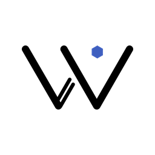

<a href="https://yingchiehwang.com">
  <picture>
    <source media="(prefers-color-scheme: dark)" srcset="assets/header-dark.svg">
    
  </picture>
</a>

  
  
  
  
  
  

<b>English</b> · <a href="README.zh-TW.md">繁體中文</a> · <a href="README.ja.md">日本語</a>

### 🔭 Research

**Light-pollution prediction for flying cars** · Yamaguchi Lab, The University of Osaka

Flying cars (Urban Air Mobility) will reflect sunlight into streets and windows. I predict this glare across a whole city by splitting the problem in two: a geometry-aware neural surrogate (PyTorch 3D-CNN + MLP) trained once in an unoccluded environment and reused across cities without retraining, plus a geometric occlusion correction for each city's buildings.

- ⚡ **Ray tracing: over 3 h → 1.62 s** to predict a 5-second window (10 Hz) at 10,000 observation points, after one-time city initialization
- 🎯 **10–54% lower RMSE** than the raw neural prediction across Rome, Taipei, and New York (18 configurations), and a **32–91% relative gain in precision** in dense high-rise New York

First author at **IEEE SmartComp 2026** · 🏆 Encouragement Presentation Award, **IPSJ ITS Workshop 2026** · Journal extension under review · [Details →](https://yingchiehwang.com/research)

### 🛠️ Built under ForgerWise

**[Wiser Locker](https://www.wiserlocker.com)** · Android · Flutter + SQLCipher  
Private photos and videos, encrypted on-device and organized by tags instead of folders. A Firebase backend (Cloud Functions, Firestore, App Check) handles Google Play subscriptions, and Google Drive provides end-to-end encrypted cloud sync. [Google Play ↗](https://play.google.com/store/apps/details?id=com.forgerwise.wiserlocker)  
  
 

**[FoodList](https://github.com/ForgerWise/FoodList)** · Android · Flutter + Hive  
Track ingredients and expiry dates so food gets used before it goes to waste. [Google Play ↗](https://play.google.com/store/apps/details?id=com.forgerwise.foodlist)  
  
 

**[Galaxization](https://galaxization.com)** · Desktop game · Windows / macOS / Linux  
A living galaxy on your wallpaper where hundreds of civilizations rise, war, and ascend on their own. Coming soon on Steam.
 

### 💼 Experience

**How Television** · Oct 2026 · 2-day developer internship — built with Claude Code and GitHub PRs/CI; top 3 of all participants on the challenge KPI  
**M3** · Oct 2026 · 2-day data analysis internship — data-driven promotion proposal for a fictional business case (pandas, statsmodels)  
**Stanby** · Aug 2026 · 4-day hackathon — architecture and Python backend for an auto-apply feature; working demo  
**PKSHA Technology** · Sep 2024 · 2 weeks — serverless Slack ranking tool with LLM summaries (AWS Lambda, EventBridge, Azure AI)  
**H&K** · Dec 2023 – May 2024 · part-time — HubSpot × fincode payment integration (Flask, AWS Lambda); the project was discontinued before launch

### 🧰 Tech stack

**Languages** 
<picture><source media="(prefers-color-scheme: dark)" srcset="https://skillicons.dev/icons?i=py&theme=dark"></picture>
<picture><source media="(prefers-color-scheme: dark)" srcset="https://skillicons.dev/icons?i=cpp&theme=dark"></picture>
<picture><source media="(prefers-color-scheme: dark)" srcset="https://skillicons.dev/icons?i=c&theme=dark"></picture>
<picture><source media="(prefers-color-scheme: dark)" srcset="https://skillicons.dev/icons?i=dart&theme=dark"></picture>
<picture><source media="(prefers-color-scheme: dark)" srcset="https://skillicons.dev/icons?i=java&theme=dark"></picture>
<picture><source media="(prefers-color-scheme: dark)" srcset="https://skillicons.dev/icons?i=ts&theme=dark"></picture>
<picture><source media="(prefers-color-scheme: dark)" srcset="https://skillicons.dev/icons?i=js&theme=dark"></picture>
<picture><source media="(prefers-color-scheme: dark)" srcset="https://skillicons.dev/icons?i=html&theme=dark"></picture>
<picture><source media="(prefers-color-scheme: dark)" srcset="https://skillicons.dev/icons?i=css&theme=dark"></picture>
 Python · C++ · C · Dart · Java · TypeScript · JavaScript · HTML · CSS

**AI & research** 
<picture><source media="(prefers-color-scheme: dark)" srcset="https://skillicons.dev/icons?i=pytorch&theme=dark"></picture>
<picture><source media="(prefers-color-scheme: dark)" srcset="https://skillicons.dev/icons?i=unreal&theme=dark"></picture>
 PyTorch · Unreal Engine 5

**Backend & cloud** 
<picture><source media="(prefers-color-scheme: dark)" srcset="https://skillicons.dev/icons?i=flask&theme=dark"></picture>
<picture><source media="(prefers-color-scheme: dark)" srcset="https://skillicons.dev/icons?i=fastapi&theme=dark"></picture>
<picture><source media="(prefers-color-scheme: dark)" srcset="https://skillicons.dev/icons?i=sqlite&theme=dark"></picture>
<picture><source media="(prefers-color-scheme: dark)" srcset="https://skillicons.dev/icons?i=aws&theme=dark"></picture>
<picture><source media="(prefers-color-scheme: dark)" srcset="https://skillicons.dev/icons?i=docker&theme=dark"></picture>
 Flask · FastAPI · SQLite · AWS · Docker

**Apps, games & tools** 
<picture><source media="(prefers-color-scheme: dark)" srcset="https://skillicons.dev/icons?i=flutter&theme=dark"></picture>
<picture><source media="(prefers-color-scheme: dark)" srcset="https://skillicons.dev/icons?i=react&theme=dark"></picture>
<picture><source media="(prefers-color-scheme: dark)" srcset="https://skillicons.dev/icons?i=godot&theme=dark"></picture>
<picture><source media="(prefers-color-scheme: dark)" srcset="https://skillicons.dev/icons?i=arduino&theme=dark"></picture>
<picture><source media="(prefers-color-scheme: dark)" srcset="https://skillicons.dev/icons?i=git&theme=dark"></picture>
<picture><source media="(prefers-color-scheme: dark)" srcset="https://skillicons.dev/icons?i=linux&theme=dark"></picture>
 Flutter · React · Godot · Arduino · Git · Linux

**AI-assisted development** 

 Beyond writing code, I use them even more as a sparring partner for thinking problems through and finding ideas. 
Hand-written first, now extended with AI: Wiser Locker, FoodList · Mostly AI: research code · Written by AI: Galaxization, my Nuxt websites, Wiser Locker's Firebase backend. 
I own the requirements and design decisions, and set what to test or let the agents design their own tests.

### 📊 Stats

  <picture>
    <source media="(prefers-color-scheme: dark)" srcset="https://github-readme-stats-forgerwises-projects.vercel.app/api?username=ForgerWise&show_icons=true&hide=issues%2Cstars&hide_rank=true&line_height=24&card_width=400&bg_color=00000000&title_color=fbbf24&icon_color=fbbf24&text_color=e4e4e7&border_color=30363d&border_radius=12">
    
  </picture>
  <picture>
    <source media="(prefers-color-scheme: dark)" srcset="https://github-readme-stats-forgerwises-projects.vercel.app/api/top-langs/?username=ForgerWise&layout=compact&hide=rust%2Cfluent%2Cwgsl&card_width=400&bg_color=00000000&title_color=fbbf24&text_color=e4e4e7&border_color=30363d&border_radius=12">
    
  </picture>

  <a href="https://leetcode.com/u/joewang85jp/">
    <picture>
      <source media="(prefers-color-scheme: dark)" srcset="https://leetcard.jacoblin.cool/joewang85jp?theme=dark&font=Inter&border=0&radius=12">
      
    </picture>
  </a>

⏱️ WakaTime — coding time by language

 
<picture>
  <source media="(prefers-color-scheme: dark)" srcset="https://github-readme-stats-forgerwises-projects.vercel.app/api/wakatime?username=ForgerWise&layout=compact&langs_count=8&hide=other&bg_color=00000000&title_color=fbbf24&text_color=e4e4e7&border_color=30363d&border_radius=12">
  
</picture>

---

Looking for new-grad software, backend, and AI engineering roles from April 2028 · 🇹🇼 Taiwan → 🇯🇵 Osaka · 中文 (native) · 日本語 (JLPT N1) · English (TOEIC 940)

